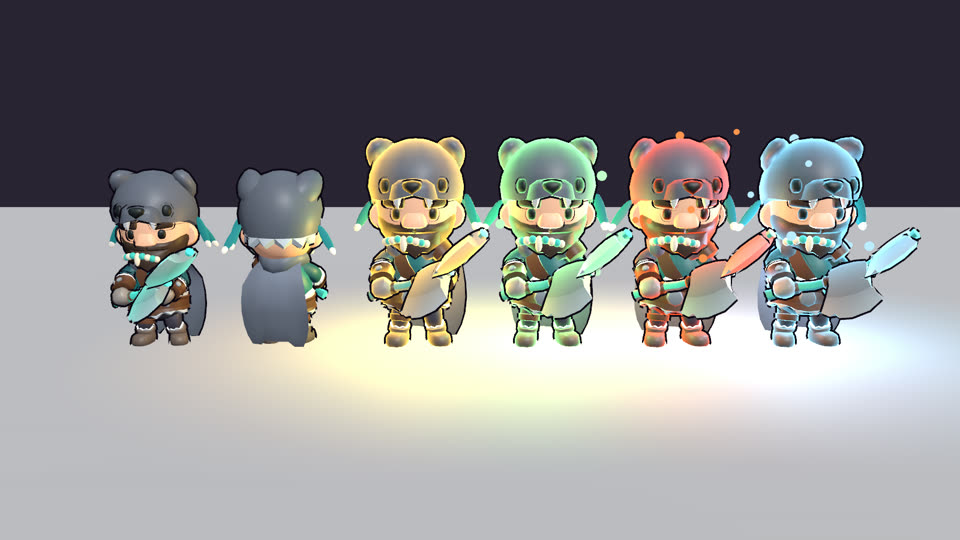

# Awaken

[](https://github.com/zakpruitt/no-name-game)
[](https://zakpruitt.github.io/no-name-game/)
[](https://godotengine.org/)
[](https://docs.godotengine.org/en/stable/tutorials/scripting/gdscript/index.html)
[](LICENSE)

A fast-paced 3D combo roguelike hack and slash. You play a shaman with twin
axes: light/heavy strings, air combos, timed combo breakers, and an element
(wind, earth or water) that reshapes every move.



## Play

Open the folder in Godot 4.7, or run it straight from a terminal:

```
godot --path .
```

VS Code works well: open the folder, install the recommended godot-tools
extension, and keep the Godot editor open (it serves completion and the
debugger). Run and debug from the Run panel; the headless checks are tasks.

The [wiki](https://zakpruitt.github.io/no-name-game/) has the controls, every move and combo, the
enemies, powers and run structure, with the numbers pulled from the game's
tuning tables.

## Credits

Models are from KayKit (CC0); see [CREDITS.md](CREDITS.md).
